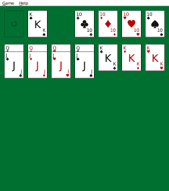
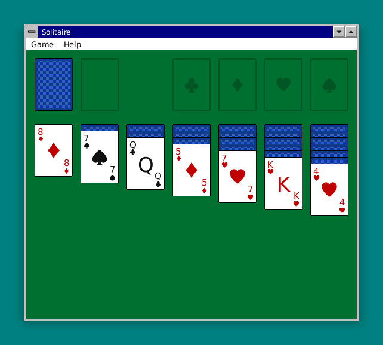
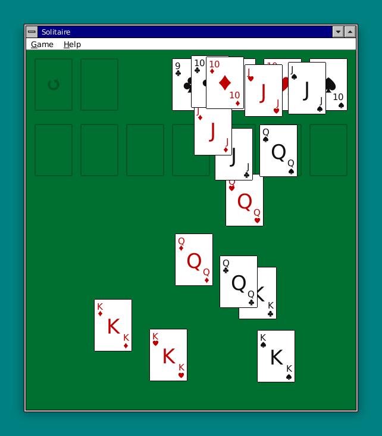

# Solitaire

[](https://github.com/roblillack/solitaire/actions/workflows/ci.yml)
[](https://crates.io/crates/solitaire)
[](LICENSE)

A classic **Klondike Solitaire**, dressed in Windows 3.1 chrome and built on the
[Saudade](https://github.com/roblillack/saudade) toolkit — green felt, a card
back that weaves, drag-and-drop, and the bouncing-cards victory cascade you
remember.



<!--
demo.gif is rendered by `examples/demo/` driving the real UI through Saudade's
offscreen MockBackend and recording each step as a GIF frame. Regenerate it with
`cargo run --release --example demo --features recorder`.
-->

## Screenshots

The opening deal — seven tableau columns, the stock and waste, and the four
foundations waiting on their Aces:



…and the win: every card home, the foundations emptying into a bouncing cascade
across the felt:



<!--
These images are rendered by `examples/screenshots.rs`, which drives the real
`Solitaire` widget through Saudade's offscreen `MockBackend`, then wraps each
window in Canoe-style chrome — title bar, frame and drop shadow — with
`render_framed`. Regenerate them with `cargo run --example screenshots`.
-->

## Playing

```sh
solitaire   # deal a new game
```

* **Move cards** by dragging. Pick up a single card or a whole face-up run and
  drop it on a tableau column (building **down in alternating colours**) or a
  foundation (building **up in suit**, Ace first). An empty column takes a King;
  an empty foundation takes an Ace.
* **Send a card home** to its foundation with a **double-click** or a
  **right-click** — no dragging required.
* **Turn the stock** by clicking it (or pressing **Space** / **Enter**). When
  it empties, clicking the marked slot recycles the waste back into it. Switch
  between turning **one** and **three** cards from the **Game** menu (**Ctrl+M**).
* **Undo** any move with **Ctrl+Z** — the whole game is undoable, right back to
  the deal.
* **Auto-Finish** (**Ctrl+F**) plays every remaining card home once the game is
  won-in-effect, then runs the celebratory cascade.

### Menus & shortcuts

The **Game** menu carries **New Deal** (Ctrl+N), **Restart Deal** (Ctrl+R),
**Undo** (Ctrl+Z), **Auto-Finish** (Ctrl+F), the draw-mode toggle (Ctrl+M) and
**Exit** (Ctrl+Q); **Help** has the About box. Menus open with their Alt
mnemonics (**Alt+G**, **Alt+H**) and the accelerators are shown beside each item.

## Architecture

The game logic never touches the toolkit — it lives behind a small, deterministic
engine that the UI reads and drives, which keeps the rules trivially testable.

| Module | Contents |
|--------|----------|
| `game` | The pure rules engine, no toolkit dependency. `Card` / `Suit` / `Rank`, a seeded SplitMix64 `Rng` (so a deal is a pure function of its seed), and `Game`: the stock / waste / four foundations / seven tableau piles, the validated move API (`draw`, `try_move`, `auto_to_foundation`, `auto_finish`), undo via whole-layout snapshots, and win detection. |
| `ui` | The Saudade front-end. `Table` draws the board and turns pointer input into moves (hand-rolled drag-and-drop, double/right-click to a foundation, and the tick-driven bouncing-cards cascade); `card_art` renders the cards from primitives, the suit pips baked from SVG at compile time (`include_svg!`, so no bitmaps and no runtime SVG parser); `layout` maps piles ↔ rectangles and does hit-testing; the menu bar feeds a command queue; and `Solitaire` is the top-level widget tying menu, board and dialogs together. |

Saudade widgets are callback-free, so one `Rc<RefCell<Game>>` is shared between
the board and the menu; the menu's items push `Command`s onto a queue that the
root widget drains after every event.

## Testing

* **Pixel snapshots** (`tests/snapshots.rs`) render the real UI through Saudade's
  offscreen `MockBackend` at 1.0× against the bundled DejaVu fonts, comparing PNG
  bytes with `insta` — the opening board, a draw, an open menu, the About dialog,
  a card mid-drag, and the winning cascade. Regenerate with
  `INSTA_UPDATE=always cargo test --test snapshots`, then review with
  `cargo insta review`.
* **Engine tests** cover the deal, the draw / recycle, every legal-move rule,
  undo, and that the demo board auto-finishes to a win.

```sh
cargo test          # everything
cargo build         # the binary
```

## Building

Solitaire builds against the [Saudade](https://github.com/roblillack/saudade)
toolkit, pulled from crates.io — no side-by-side checkout needed:

```sh
git clone https://github.com/roblillack/solitaire
cd solitaire
cargo run --release
```

On Linux the toolkit links libwayland and libxkbcommon; install the dev packages
first (`libwayland-dev libxkbcommon-dev pkg-config` on Debian/Ubuntu). macOS and
Windows need nothing extra.

## License

MIT — see [LICENSE](LICENSE).
